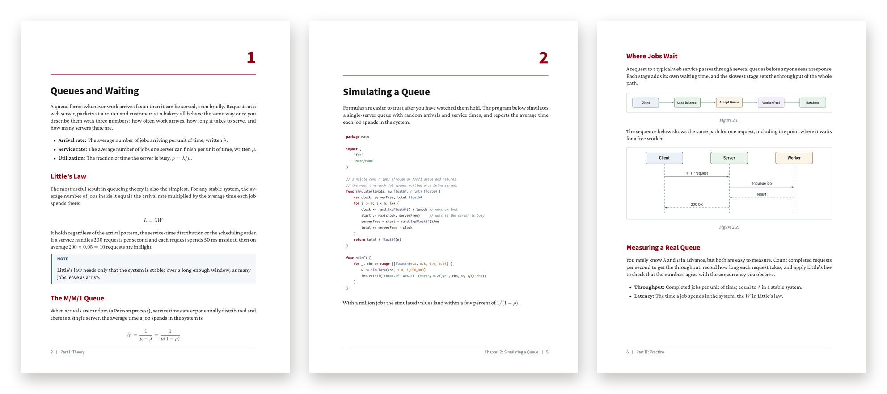
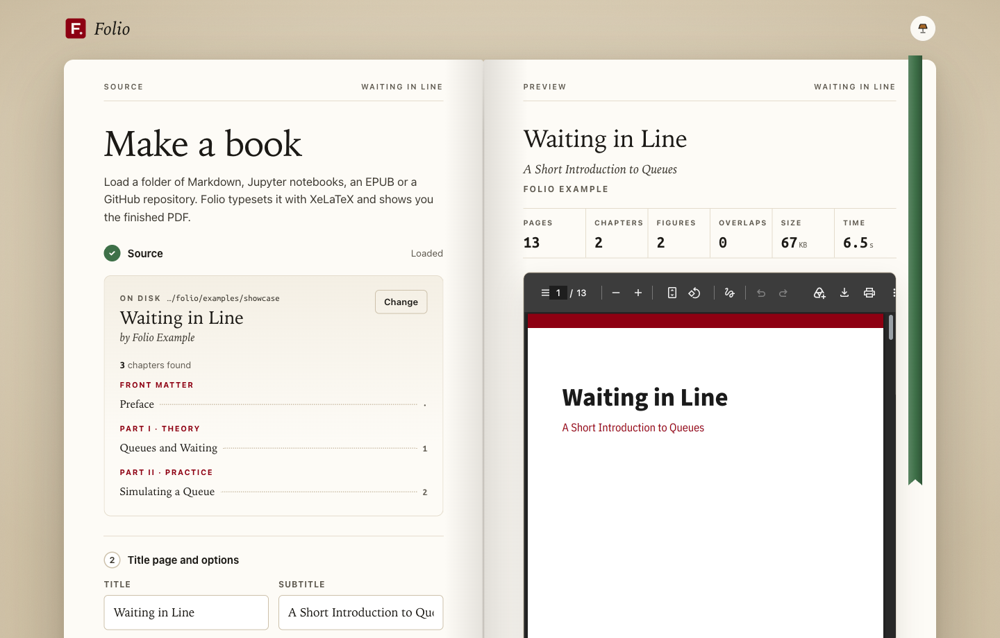

<p align="center">
  
</p>

<h1 align="center">Folio</h1>

<p align="center">
  Typeset Markdown, Jupyter notebooks and EPUB files into print-quality PDF books.
</p>

<p align="center">
  <a href="go.mod"></a>
  <a href="https://tectonic-typesetting.github.io/"></a>
  <a href="LICENSE"></a>
</p>

<p align="center">
  
</p>

Folio reads a book written as plain files and produces a PDF that looks like it came from a publisher. It generates LaTeX and compiles it with [Tectonic](https://tectonic-typesetting.github.io/), so the result has real mathematical typesetting, hyphenation and justified text, syntax-highlighted code, and diagrams drawn as vectors rather than pasted in as screenshots. After compiling, it checks the PDF for figure labels that collide and for characters that no font could render.

```bash
folio build ./my-book -o my-book.pdf
```

The pages above come from [`examples/showcase`](examples/showcase), a thirteen-page book that you can build yourself.

## Contents

- [Features](#features)
- [Installation](#installation)
- [Usage](#usage)
- [Writing a book](#writing-a-book)
- [Configuration](#configuration)
- [Typefaces](#typefaces)
- [Reproducible builds](#reproducible-builds)
- [The desk](#the-desk)
- [Status and limitations](#status-and-limitations)
- [Development](#development)
- [Acknowledgements](#acknowledgements)

## Features

|  |  |
|--|--|
| **Sources** | Folders of Markdown, MDX or Jupyter notebooks; EPUB files; public GitHub and GitBook repositories |
| **Book structures** | Reads mdBook and GitBook `SUMMARY.md`, Jupyter Book `_toc.yml` and `myst.yml`, Carpentries `config.yaml`, and `[X.Y.Z]` front-matter ids |
| **Mathematics** | Inline `$...$` and display `$$...$$` LaTeX, typeset with `amsmath` |
| **Diagrams** | Mermaid flowcharts and sequence diagrams, and ASCII box diagrams, laid out and drawn in TikZ |
| **Code** | Highlighting for more than 250 languages via [Chroma](https://github.com/alecthomas/chroma), with long lines wrapped instead of clipped |
| **Book furniture** | Cover, title and copyright pages, table of contents, part openers, running heads, numbered figures and a back-of-book index |
| **Scripts** | Chinese, Japanese and Korean text is set in a matching installed font, chosen by checking each font's glyph coverage |
| **Verification** | Flags overlapping labels inside figures, overfull lines, and any characters missing from the PDF |
| **Reproducibility** | Free fonts by default, so the same source builds a byte-identical PDF on any machine |
| **Interface** | A command-line tool, plus a local web interface for building and previewing books |

## Installation

Folio needs [Tectonic](https://tectonic-typesetting.github.io/en-US/install.html) to compile PDFs. [Poppler](https://poppler.freedesktop.org/) is optional and enables the figure check.

```bash
# macOS
brew install tectonic poppler

# Debian / Ubuntu
sudo apt install poppler-utils   # then install Tectonic from its releases page
```

Install Folio with Go 1.25 or later:

```bash
go install github.com/Oyetomi/folio/cmd/folio@latest
```

Or build it from source:

```bash
git clone https://github.com/Oyetomi/folio.git
cd folio
go build -o folio ./cmd/folio
```

The first build downloads the TeX support files Tectonic needs (about 50 MB) and caches them, which can take a few minutes. Later builds start immediately.

## Usage

```bash
folio build ./my-book                                      # a folder of Markdown
folio build ./novel --no-index -o novel.pdf                # skip the index for fiction
folio build ./book.epub                                    # an EPUB
folio build https://github.com/owner/book                  # a public repository
folio serve                                                # the local web interface
```

| Command | Description |
|---------|-------------|
| `folio build [source]` | Build a PDF from a folder, `.epub` file or GitHub/GitBook URL. Defaults to the current directory. |
| `folio serve` | Open the desk, a local web interface, at `http://localhost:7350`. |
| `folio check [source]` | Discover chapters and metadata without compiling. |
| `folio verify <file.pdf>` | Check an existing PDF for overlapping figure labels. Exits with status 1 if any are found. |
| `folio init` | Write a starter `folio.yml` in the current directory. |
| `folio version` | Print the version. |

<details>
<summary><strong>Options for <code>folio build</code></strong></summary>

| Option | Description |
|--------|-------------|
| `-o`, `--out <file>` | Output path. Defaults to `output` in `folio.yml`, or `book.pdf`. |
| `--title`, `--subtitle`, `--author` | Override the metadata found in the source. |
| `--cover <image>` | Use this image as the front cover. |
| `--fonts <mode>` | `open` (default), `pro` or `mono`. See [Typefaces](#typefaces). |
| `--fonts-dir <dir>` | An extra directory to search for fonts. |
| `--no-index` | Leave out the back-of-book index. |
| `--keep-tex` | Write the generated `.tex` file next to the PDF. |
| `--verify=false` | Skip the figure check after compiling. |

</details>

## Writing a book

A book is a folder of Markdown files. Folio orders chapters by the structure files listed above when they exist, otherwise by front-matter ids, otherwise by file name.

```markdown
---
id: "[1.2.0]"            # part 1, chapter 2
title: "Little's Law"
---

# Little's Law

For any stable system, $L = \lambda W$.

- **Utilization:** The fraction of time the server is busy.
```

Beyond standard Markdown, Folio understands the following.

| Write | Get |
|-------|-----|
| `$...$`, `$$...$$` | Inline and display mathematics |
| ` ```mermaid ` with `flowchart` or `sequenceDiagram` | A vector diagram with a numbered caption |
| A fenced block of `+--+` box drawing | The same diagram, redrawn in vector |
| `` | A numbered figure; images are resolved relative to the chapter |
| `> [!NOTE]`, `> [!TIP]`, `> [!WARNING]`, `> [!CAUTION]`, `> [!IMPORTANT]` | Callout boxes |
| `<Note>`, `<Tip>`, `<Warning>`, `<DeepDive>`, `<Axiom>` (MDX) | Callout boxes |
| `- **Term:** definition` | An entry in the back-of-book index |
| `* * *` | A centred scene break |
| `> quoted text` | An epigraph or quotation |

## Configuration

Folio works without configuration, taking the title and author from `README.md`, `book.toml` or the other files it recognises. For control over the front matter, add a `folio.yml` (or run `folio init`):

```yaml
title: "Waiting in Line"
subtitle: "A Short Introduction to Queues"
author: "Jane Doe"
source: chapters            # folder containing the chapters
output: waiting-in-line.pdf
fonts: open
cover_image: assets/cover.jpg
parts:
  - index: 1
    title: "Theory"
    description: "What a queue is, and the two results worth remembering."
```

<details>
<summary><strong>All <code>folio.yml</code> keys</strong></summary>

| Key | Description |
|-----|-------------|
| `title`, `subtitle`, `author` | Shown on the cover and title page. |
| `source` | Folder containing the chapters, relative to the book root. Default `docs`; falls back to the root. |
| `output` | Default output file name. |
| `fonts` | `open`, `pro` or `mono`. See [Typefaces](#typefaces). |
| `cover_image` | Front-cover image. `render.cover_image` is also accepted. |
| `description` | Paragraph on the inside cover. |
| `highlights` | Bullet points on the inside cover. |
| `author_bio` | Author note on the inside cover. Markdown is allowed. |
| `license_text`, `license_code` | Licences printed on the copyright page. |
| `repo_url`, `default_branch` | Turns relative links such as `../exercises/x.go` into links to the repository. |
| `no_index` | `true` to leave out the index. |
| `parts` | Part titles and descriptions, keyed by `index`. |

Folio also reads `go-pretty-pdf.yml`, so existing projects that use that file build without changes.

</details>

## Typefaces

| Mode | Body | Headings | Labels | Use it when |
|------|------|----------|--------|-------------|
| `open` *(default)* | Crimson Pro | Source Sans Pro | IBM Plex Sans Condensed | You want a book anyone can rebuild. All are SIL Open Font License fonts from Tectonic's bundle. |
| `pro` | Minion Pro | Myriad Pro | Myriad Pro Condensed | You hold licences for these fonts and have placed them in `~/.folio/fonts`. |
| `mono` | Ubuntu Mono | Ubuntu Mono | Ubuntu Mono | You want an all-monospace look. |

Code is always set in Ubuntu Mono, which is embedded in the binary. Choose the mode with `fonts:` in `folio.yml`, the `--fonts` option, or the `FOLIO_FONTS` environment variable; that is also the order of precedence, with `--fonts` winning. If `pro` is requested where the fonts are not installed, the build stops with a message saying so rather than falling back quietly.

Chinese, Japanese and Korean text is set in an installed font that covers it: Songti and AppleMyungjo on macOS, Noto CJK on Linux, or any font placed in `~/.folio/fonts`. Characters that no available font can render, currently emoji and right-to-left scripts, are listed at the end of the build instead of disappearing from the page.

## Reproducible builds

With the default `open` fonts, a build depends only on the source and the Folio and Tectonic versions. Fixing the timestamp makes the output byte-identical from one run or machine to the next:

```bash
SOURCE_DATE_EPOCH=$(git log -1 --format=%ct) folio build . --fonts open -o book.pdf
```

This makes Folio suitable for building books in continuous integration, where the PDF can be published from a tagged commit and rebuilt by anyone to confirm it. Books containing Chinese, Japanese or Korean text also depend on which CJK font is installed, so pin that font in CI as well.

## The desk

`folio serve` opens a web interface for the same pipeline. Load a book by dropping a folder or EPUB, pasting a GitHub URL or giving a local path; edit the title page; and follow the build as it runs. The finished PDF opens beside the controls with its page count, figure check and download links, and recent books stay on a shelf for reopening.

<p align="center">
  
</p>

The desk is meant for the machine it runs on. It listens on `localhost`, refuses requests from other origins, and keeps uploads and builds in a temporary directory that is deleted when it exits.

## Status and limitations

Folio is at version 0.1. It builds long technical books reliably, and the output format may still change between minor versions.

- The Markdown reader is written for books and is not a complete CommonMark implementation. Unusual nesting can produce unexpected output; please report it with a small example.
- Mermaid support covers `flowchart`/`graph` and `sequenceDiagram`. Other diagram types are not drawn.
- Right-to-left scripts (Arabic, Hebrew) and emoji are not typeset yet. They are reported when a build drops them.
- EPUB import keeps text, tables, images and MathML, but drops link targets.

## Development

```bash
go test ./...            # unit, golden and end-to-end tests (needs Tectonic for the last)
go test -short ./...     # skip the Tectonic compiles
go test ./... -update    # rewrite golden files after an intended output change
```

Golden files under `internal/*/testdata` record the LaTeX generated for each fixture, so any change in output shows up as a reviewable diff. The end-to-end tests compile every fixture in every font mode and fail on missing glyphs, undefined font shapes or overlapping figure labels.

The desk's interface is a React and TypeScript app in [`web/`](web/), built with Vite into `internal/server/dist/` and embedded in the binary, so people who install Folio never need Node.

```bash
go run ./cmd/folio serve --no-open   # API on :7350
cd web && npm install && npm run dev # interface with hot reload on :5173
```

Run `npm run build` in `web/` before committing interface changes, and commit `internal/server/dist/` with them.

| Package | Responsibility |
|---------|----------------|
| `cmd/folio` | Command-line interface |
| `internal/build` | The pipeline shared by the CLI and the desk |
| `internal/config` | `folio.yml` and metadata discovery |
| `internal/markdown` | Chapter discovery, the Markdown reader and image resolution |
| `internal/epub` | EPUB import |
| `internal/latex` | Document assembly, typefaces and script fallback |
| `internal/tikz` | Mermaid and ASCII diagram layout |
| `internal/highlight` | Code highlighting and LaTeX escaping |
| `internal/verify` | Post-compile checks |
| `internal/server` | The desk's HTTP server |

## Acknowledgements

PDFs are compiled by [Tectonic](https://tectonic-typesetting.github.io/), and code is highlighted by [Chroma](https://github.com/alecthomas/chroma).

## License

Folio is released under the [MIT License](LICENSE). The typefaces used in `open` mode are distributed under the SIL Open Font License by their authors.
