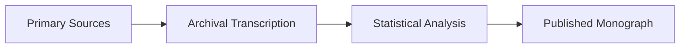

# Folio

**Folio** is a universal typesetting and vector book compiler written in Go. It transforms Markdown/MDX manuscripts, `.epub` archives, or GitHub repositories directly into print-ready, press-grade PDF books powered by XeLaTeX and native PGF/TikZ vector graphics.

Unlike browser-based HTML-to-PDF converters (such as Chromium or wkhtmltopdf) that produce bloated files with rasterized diagrams, uneven page breaks, and clipped tables, Folio compiles manuscripts through a true book-publishing pipeline:

- **Universal Genre Support**: Built for textbooks, mathematics and science treatises, literary fiction, essays, business and finance books, historical monographs, and software engineering manuals.
- **Native LaTeX Mathematics**: First-class support for inline equations (`$E = mc^2$`) and display equations (`$$ ... $$`) via `amsmath` and `amssymb`.
- **Native Vector Diagrams**: Automatically compiles `mermaid` (`flowchart` and `sequenceDiagram`) and ASCII box/layer diagrams into infinitely scalable PGF/TikZ vector graphics—never blurry PNG screenshots.
- **250+ Language Syntax Highlighting**: Powered by [Chroma](https://github.com/alecthomas/chroma), supporting Python, Rust, SQL, C, C++, TypeScript, Java, Go, R, Julia, TeX, Haskell, and over 250 other languages out of the box.
- **Full-Width Adaptive Tables**: Automatically calculates column character-density weights so every Markdown table spans 100% of `\textwidth` with wrapped cells and repeating headers across page breaks.
- **Automated Back-of-Book Indexing**: Extracts defined concepts (`- **Term:** ...`) and technical symbols into a two-column alphabetical index with exact page references (or disable with `--no-index` for novels and essay collections).
- **Post-Compile Bounding-Box Verification**: Audits every figure in the compiled PDF via `pdftotext -bbox` to guarantee zero overlapping text labels and checks TeX logs for overfull boxes.

---

## Requirements

- **Go** `1.22+` (to build from source)
- **Tectonic** (`brew install tectonic` on macOS, or via [tectonic-typesetting.github.io](https://tectonic-typesetting.github.io/))
- **Poppler** (`brew install poppler` — optional, used by `folio verify` for `pdftotext -bbox` figure collision auditing)

---

## Installation

```bash
go install github.com/Oyetomi/folio/cmd/folio@latest
```

Or build from source:

```bash
git clone https://github.com/Oyetomi/folio.git
cd folio
go build -o folio ./cmd/folio
```

---

## Quick Start

### 1. Compile a Local Markdown / MDX Book Directory

```bash
folio build ./my-book -o my-book.pdf
```

### 2. Compile Any Public GitHub Book Repository Directly

```bash
folio build https://github.com/sazardev/networking-with-go -o Networking-with-Go.pdf
```

### 3. Convert an `.epub` Book into a Print-Ready PDF

```bash
folio build ./book.epub -o book-print.pdf
```

### 4. Compile Fiction, Essays, or Memoirs (Without Back-of-Book Index)

```bash
folio build ./novel-manuscript --no-index -o novel.pdf
```

### 5. Run Standalone Typography & Collision Audit on Any PDF

```bash
folio verify ./book-print.pdf
```

---

## Configuration (`folio.yml`)

Folio works with zero configuration by auto-discovering chapters, frontmatter, and `README.md` metadata. For full editorial control over front matter, part openers, and cover design, run `folio init` to generate a `folio.yml` file:

```yaml
title: "Foundations of Natural Philosophy"
subtitle: "History, Mathematics, and Computation"
author: "Clara Vance"
source: chapters
output: foundations.pdf
cover_image: assets/cover.jpg
description: "An interdisciplinary treatise bridging classical natural philosophy, modern stochastic mathematics, and computational modeling."
highlights:
  - "Historical foundations of scientific inquiry and empirical reasoning"
  - "Exact mathematical formulations of entropy, diffusion, and pricing"
  - "Computational simulations and reproducible models"
author_bio: "**Clara Vance** is a historian of science and applied mathematician."
license_text: "Creative Commons Attribution-NonCommercial 4.0 International (CC BY-NC 4.0)."
license_code: "MIT License (MIT)."
no_index: false
parts:
  - index: 1
    folder: "01-foundations"
    title: "Part I: Foundations"
    description: "Core principles and historical context."
```

---

## Manuscript Features

### Mathematics (`$...$` and `$$...$$`)

Write standard LaTeX math anywhere in prose, lists, tables, or callouts:

```markdown
The diffusion coefficient $D = \frac{k_B T}{6 \pi \eta r}$ governs the evolution of density $\rho(x,t)$:

$$
\frac{\partial \rho(x, t)}{\partial t} = D \frac{\partial^2 \rho(x, t)}{\partial x^2}
$$
```

### Literary Scene Breaks & Epigraphs

Horizontal rules (`* * *` or `---`) render as classical centered ornamental breaks (`*  *  *`), and standard blockquotes (`> ...`) render as italicized editorial epigraphs or excerpts.

### Editorial Callouts & Admonitions

Folio supports GitHub-style alerts (`> [!NOTE]`, `> [!TIP]`, `> [!IMPORTANT]`, `> [!WARNING]`, `> [!CAUTION]`), bold-titled blockquotes (`> **Historical Context:** ...`), and MDX callout tags (`<Note>`, `<Tip>`, `<Warning>`, `<DeepDive>`, `<Axiom>`):

```markdown
> [!NOTE]
> Primary sources from the Royal Society archives are cited by folio number.
```

### Native Vector Diagrams (`mermaid` & ASCII)

Fenced `mermaid` blocks (`flowchart LR`, `flowchart TD`, `sequenceDiagram`) are parsed into an abstract graph and laid out automatically using layered topological ranking in PGF/TikZ:

````markdown

````

### Figures & Illustrations

Standard Markdown images (``) are automatically staged and rendered inside centered figure frames with numbered captions (`Figure 1.1. Caption text`).

---

## Custom Typography & Fonts (`~/.folio/fonts`)

Folio embeds open-source `UbuntuMono` fonts directly inside the binary so it works out of the box on any machine.

For commercial-press serif and sans-serif typography, place your licensed `.otf` font family files (`MinionPro-*.otf` and `MyriadPro-*.otf`) into `~/.folio/fonts/` (or pass `--fonts-dir /path/to/fonts` / set `FOLIO_FONTS_DIR`). Folio automatically detects them at build time and activates full proportional serif body typography, condensed sans-serif figure captions, and semibold display headings.

---

## License

MIT License. See [LICENSE](LICENSE) for details.
