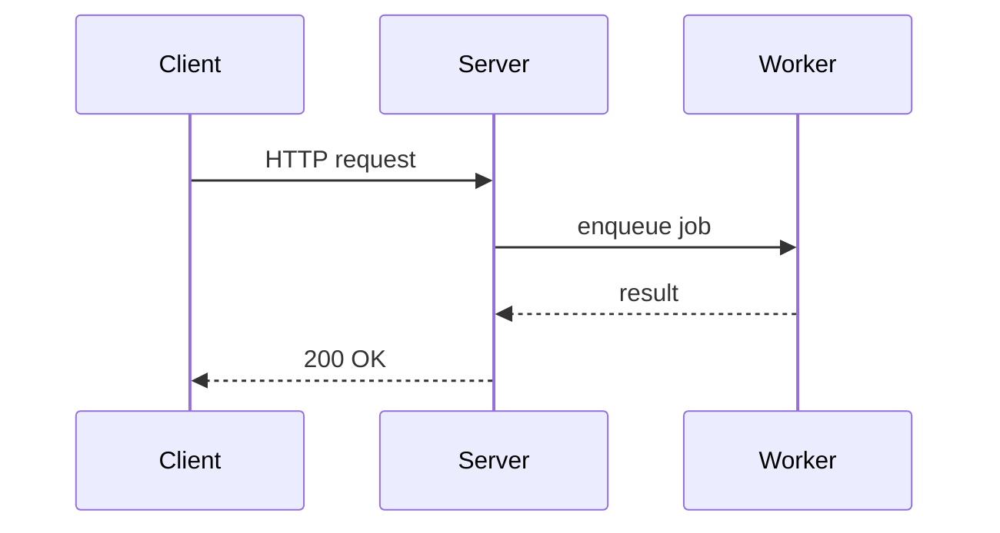

# Simulating a Queue

Formulas are easier to trust after you have watched them hold. The program below simulates a single-server queue with random arrivals and service times, and reports the average time each job spends in the system.

```go
package main

import (
	"fmt"
	"math/rand"
)

// simulate runs n jobs through an M/M/1 queue and returns
// the mean time each job spends waiting plus being served.
func simulate(lambda, mu float64, n int) float64 {
	var clock, serverFree, total float64
	for i := 0; i < n; i++ {
		clock += rand.ExpFloat64() / lambda // next arrival
		start := max(clock, serverFree)     // wait if the server is busy
		serverFree = start + rand.ExpFloat64()/mu
		total += serverFree - clock
	}
	return total / float64(n)
}

func main() {
	for _, rho := range []float64{0.5, 0.8, 0.9, 0.95} {
		w := simulate(rho, 1.0, 1_000_000)
		fmt.Printf("rho=%.2f  W=%.2f  (theory %.2f)\n", rho, w, 1/(1-rho))
	}
}
```

With a million jobs the simulated values land within a few percent of $1/(1-\rho)$.

## Where Jobs Wait

A request to a typical web service passes through several queues before anyone sees a response. Each stage adds its own waiting time, and the slowest stage sets the throughput of the whole path.


The sequence below shows the same path for one request, including the point where it waits for a free worker.



## Measuring a Real Queue

You rarely know $\lambda$ and $\mu$ in advance, but both are easy to measure. Count completed requests per second to get the throughput, record how long each request takes, and apply Little's law to check that the numbers agree with the concurrency you observe.

- **Throughput:** Completed jobs per unit of time; equal to $\lambda$ in a stable system.
- **Latency:** The time a job spends in the system, the $W$ in Little's law.
